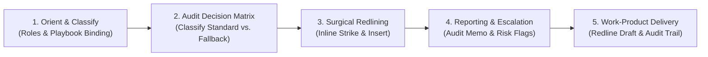

# Contract Review & Redlining

## Overview

The `contract-review-and-redlining` skill acts as an automated legal compliance
and redlining engine that reviews commercial contracts, non-disclosure
agreements (NDAs), and Master Services Agreements (MSAs) against corporate legal
playbooks.

Operating with the objective precision of senior contract review counsel, the
skill mechanically enforces organizational standards, classifies deviations, and
applies pre-approved fallback language. Rather than introducing unauthorized
"middle-ground" compromises, it produces surgical markups that preserve
acceptable counterparty language while firmly protecting corporate risk
boundaries.

## Key Capabilities

-   **Playbook-Driven Compliance Review**: Audits inbound counterparty drafts
    against organizational playbooks, classifying provisions into Standard,
    Acceptable Fallback, or Non-Negotiable Deviation.
-   **Surgical Inline Redlining**: Generates precise strike-and-replace markups
    (`~~deletions~~` and `**insertions**`) without disrupting surrounding
    acceptable contract language.
-   **Security Boundary Isolation**: Isolates untrusted contract text within
    `<untrusted_document_body>` XML tags to thwart prompt injection and
    adversarial jailbreak exploits.
-   **No Unauthorized Compromises**: Eliminates spontaneous or unvetted
    middle-ground concessions by strictly adhering to approved escalation
    thresholds.
-   **Progressive Legal Architecture**: Selectively consults modular reference
    guides (`context-setup.md`, `decision-logic.md`, `surgical-drafting.md`,
    `reporting-schema.md`) to maintain sharp analytical focus.

## How it Works (Core Pattern)



1.  **Orient & Classify**: Establishes party roles (Buyer vs. Seller, Discloser
    vs. Recipient), identifies agreement typology, and binds the review to the
    designated corporate playbook. Isolates external contract language within
    `<untrusted_document_body>` delimiters.
2.  **Audit Decision Matrix**: Audits contract clauses against playbook
    standards, classifying terms into Standard, Acceptable Fallback, or
    Non-Negotiable Deviation with severity ratings.
3.  **Draft Surgical Redlines**: Generates precise inline markups applying
    pre-approved fallback clauses (`**insertions**` and `~~deletions~~`) without
    disrupting acceptable counterparty phrasing or legal boilerplate.
4.  **Reporting & Escalation Memo**: Compiles an executive summary table
    detailing deviations, severity ratings, commercial rationales, fallback
    citations, and explicit triggers for senior legal leadership.
5.  **Work-Product Delivery**: Emits the publication-ready redlined contract
    draft alongside a structured negotiation audit trail.

## Directory Structure

```
contract_review_redlining/
├── SKILL.md                          # Master skill orchestrator and review pipeline
├── README.md                         # Architecture, capabilities, and workflow guide
├── BUILD                             # Bazel build and packaging target
├── EVAL.txtpb                        # Automated evaluation suite (27 test cases)
├── references/                       # Decision logic, reporting, and redline rules
└── OWNERS                            # Maintainer ownership metadata
```

## Examples of How to Use the Skill

Here are some example prompts you can use to trigger this skill:

### Example 1: Full Contract Review Against a Playbook

**Prompt:**

> "Review the attached third-party SaaS Agreement against our Software
> Procurement Playbook. Provide surgical redlines and an executive summary table
> of all deviations."

**Expected Outcome:** The agent compares every clause against playbook rules,
produces inline redlines (`**insertions**` and `~~deletions~~`), and outputs a
structured audit table with section citations and commercial rationales.

### Example 2: Targeted Clause Redlining

**Prompt:**

> "Redline Section 9 (Indemnification) and Section 10 (Limitation of Liability)
> of the vendor contract to align with our standard commercial terms."

**Expected Outcome:** The agent evaluates the specific sections, identifies
deviations from corporate policy, and drafts surgical redline amendments with
clear negotiation comments.

### Example 3: Auditing Counterparty NDA for Non-Negotiables

**Prompt:**

> "Review this mutual NDA received from our counterparty. Apply our company
> standard fallbacks and highlight any non-negotiable clauses."

**Expected Outcome:** The agent flags unilateral non-disclosure terms, applies
mutual fallback language, and alerts counsel to any non-negotiable intellectual
property or non-solicitation covenants.
