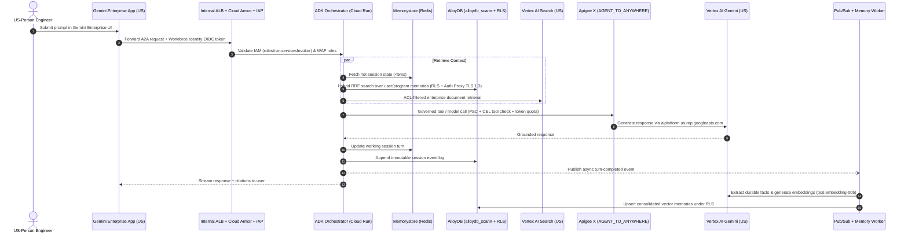

# [Project/Customer Name]: Gemini Enterprise Agent Platform ITAR Compliance & Reference Architecture

> **Document Realm**: Architecture & Design Specification (Code-Free)
> **Compliance Regime**: Google Cloud Assured Workloads — ITAR (`OFFERING_ITAR`)
> **Jurisdictional Endpoints**: `aiplatform.us.rep.googleapis.com` | `discoveryengine.us.rep.googleapis.com`

---

## 1. Executive Summary & Architectural Objectives

*Summarize the mission objective, the target user experience (e.g., Gemini Enterprise App workbench vs. custom portal), the data sensitivity classification (22 CFR Parts 120–130 ITAR Technical Data), and the core architectural strategy: combining the ITAR-compliant Gemini Enterprise Front Door and Vertex AI US Multi-Region Foundation with a self-hosted ADK Runtime, Dual-Gate Private BYO-MCP Tooling, and an ITAR-compliant Dual-Tier Memory Bank.*

---

## 2. Workload Scope, Compliance Boundary & Landing Zone Enrollment

| Dimension | Target Specification |
| :--- | :--- |
| **Primary Use Case** | *[e.g., Engineering Technical Data Assistant / Contract Lifecycle Management Agent]* |
| **Experience Surface** | *[e.g., Gemini Enterprise App (`discoveryengine.us.rep.googleapis.com`) via A2A protocol (`--registration-type a2a`)]* |
| **Assurance Control Package** | Google Cloud Assured Workloads **ITAR (`OFFERING_ITAR`)** |
| **Landing Zone Enrollment Mode** | *[Greenfield Assured Workloads v1 (`CONSUMER_FOLDER`, Preventive Day 0) OR Brownfield Assured Workloads v2 / Compliance Manager (`Detective` Monitor Mode with Continuous Evaluation Service [CES] -> `Preventive` + Custom `Detective` CEL Cloud Controls)]* |
| **Allowed Regions** | US Multi-Region (`us`) and accredited US regions (`us-central1`, `us-east4`, `us-west1`, `us-east1`) |
| **Encryption Standard** | Customer-Managed Encryption Keys (**CMEK**) via Cloud KMS / Cloud HSM (`destroyScheduledDuration >= 30 days`) |
| **Identity & Access Control** | Workforce Identity Federation / Cloud Identity with end-to-end User ACL propagation |

---

## 3. Agent Platform ITAR Compliance Matrix

*Insert the 4-pillar compliance assessment (Build, Scale, Govern, Optimize) from `references/compliance-matrix.md` tailored to the customer's requested services, clearly distinguishing:*
1. **Compliant & Authorized (`OFFERING_ITAR`)**
2. **Hard-Blocked in Platform Code (`ALLOW_ONLY_ITAR_COMPLIANT_APIS_ORG_POLICY`)**
3. **Excluded by ITAR Policy (`_itar.yaml` / `deploy-gemini-gov.md`)**

---

## 4. End-to-End ITAR Reference Architecture

### 4.1 High-Level System Topology

```mermaid
flowchart TB
    subgraph Users["US-Person Authorized Personnel"]
        UI["Gemini Enterprise App Web UI\n(Workforce Identity / Cloud Identity SSO)"]
    end

    subgraph AW["Assured Workloads ITAR Folder (US Region Lock + VPC-SC + CMEK)"]
        subgraph FrontDoor["Experience & Grounding Tier (discoveryengine.us.rep.googleapis.com)"]
            GE["Gemini Enterprise App Engine\n(personalization-memory = OFF | A2A Mode)"]
            VAIS["Vertex AI Search DataStores\n(Source ACLs + US Multi-Region CMEK)"]
        end

        subgraph RuntimeTier["Self-Hosted Agent Runtime & Ingress Gate (Cloud Run / GKE Private)"]
            ALB["Internal / Regional ALB + Cloud Armor WAF + IAP\n(CLIENT_TO_AGENT Gate + CEL Tool Authz)"]
            ADK["ADK Orchestrator & Sub-Agents\n(ephemeral-disk-disable=true | disabled run.app)"]
            DLP["Cloud DLP Inspection Gate\n(dlp.us.rep.googleapis.com)"]
            SANDBOX["GKE Sandbox (gVisor + restricted PSS)\n(Zero-Egress Code Execution)"]
        end

        subgraph MemoryTier["ITAR Dual-Tier Session & Memory Bank"]
            REDIS["Memorystore for Redis\n(Hot Working Session Cache - TLS + CMEK)"]
            ALLOY["AlloyDB for PostgreSQL + pgvector (alloydb_scann)\n(Auth Proxy TLS 1.3 + RLS + RRF Hybrid Search + PITR)"]
            PUBSUB["Cloud Pub/Sub + Cloud Run Worker\n(Async Memory Consolidation)"]
            BQ["BigQuery VECTOR_SEARCH + Agent Analytics\n(Enterprise Precedent Archive & Telemetry)"]
        end

        subgraph ModelTier["Model Inference Tier (aiplatform.us.rep.googleapis.com)"]
            GEMINI["Vertex AI Gemini 1.5 Pro / Flash\n(US Multi-Region + Zero Data Retention)"]
            EMBED["Vertex AI Embeddings (text-embedding-005)\n(US Multi-Region)"]
        end

        subgraph ToolTier["Dual-Gate Outbound BYO-MCP & Enterprise Integration Tier"]
            APIGEE["Apigee X + Service Extensions (ext-proc)\n(AGENT_TO_ANYWHERE Gate + PSC + Token Quotas)"]
            MCP["Self-Hosted FastMCP & MCP Toolbox for Databases\n(Streamable HTTP on Cloud Run)"]
        end
    end

    UI -->|HTTPS| GE
    GE -->|A2A + OIDC Token (roles/run.servicesInvoker)| ALB
    ALB -->|Verified Request| ADK
    ADK -->|1. Inspect Prompt/Output| DLP
    ADK -->|2. Hot Session Read/Write| REDIS
    ADK -->|3. Hybrid RRF Recall (alloydb_scann + RLS)| ALLOY
    ADK -->|4. Grounded Enterprise Search| VAIS
    ADK -->|5. Precedent Search & Analytics| BQ
    ADK -->|6. Inference & Embeddings| GEMINI
    ADK -->|7. Governed Tool Call| APIGEE
    APIGEE -->|PSC + mTLS / IAM| MCP
    ADK -->|8. Isolated Execution| SANDBOX
    ADK -.->|9. Turn Event| PUBSUB
    PUBSUB -.->|10. Extract & Embed Facts| EMBED
    PUBSUB -.->|11. Upsert Fact Vector| ALLOY
```

### 4.2 Component-by-Component Substitution Matrix

| Non-Compliant Managed Component | ITAR-Compliant Replacement Pattern | Key Architectural Controls |
| :--- | :--- | :--- |
| **Managed Agent Runtime (`AgentService` / Sobi)** | **ADK on Cloud Run** or **GKE Private Cluster** + **Sovereign Observability** | `run.googleapis.com/ephemeral-disk-disable: "true"`, disabled `run.app` URL, separate `-app` / `-runner` SAs, Cloud Trace + `NO_CONTENT` Cloud Logging + CMEK BigQuery Agent Analytics |
| **Managed Agent Sessions** | **Memorystore for Redis** + **AlloyDB for PostgreSQL** | Write-through cache; TLS + AUTH + CMEK; immutable audit trail |
| **Managed Memory Bank (`MemoryBundleService`) & GE `personalization-memory`** | **AlloyDB `pgvector` (`alloydb_scann`)** + **Pub/Sub Async Consolidation** + **BigQuery `VECTOR_SEARCH`** | AlloyDB Auth Proxy TLS 1.3 + IAM auth, locked `search_path`, Row-Level Security (RLS), RRF hybrid lexical+vector search, Multi-Zone HA + PITR, MCP Toolbox for Databases |
| **Google Cloud Hosted MCP Servers & Skill Registry** | **Self-Hosted BYO-MCP (Streamable HTTP)** + **Apigee X (`ext-proc`)** + **IAP CEL Tool Rules** | Dual-Gate `CLIENT_TO_AGENT` & `AGENT_TO_ANYWHERE` governance over PSC; IAP CEL rules on `iap.googleapis.com/mcp.toolName`; Apigee `llm-token-quota` |
| **Managed Code Sandboxes (`SandboxEnvironmentService`)** | **GKE Sandbox (`gVisor`)** or **Cloud Run Jobs** | `restricted` Pod Security Standards; Secret Manager CSI Driver; Dataplane V2 `DENY ALL` egress `NetworkPolicy` + `NetworkLogging` |
| **Public Search / Maps Grounding** | **Vertex AI Search** (`discoveryengine.us.rep.googleapis.com`) | `disableGenAIGoogleSearchGrounding` Org Policy; DataStore ACL enforcement |

---

## 5. End-to-End Request & Memory Lifecycle Flow



---

## 6. Architectural Trade-Off Decisions

### 6.1 Runtime Compute: Cloud Run vs. GKE Private Clusters
*Document why Cloud Run vs. GKE was selected for the orchestrator and sandbox tiers.*

### 6.2 Semantic Memory Tier: AlloyDB `pgvector` (`alloydb_scann`) vs. BigQuery `VECTOR_SEARCH` vs. Vertex AI Vector Search
*Document the hot interactive memory tier vs. large-scale analytical precedent tier.*

---

## 7. Google Cloud Well-Architected Framework (WAF) 6-Pillar Alignment

*Include the 6-pillar WAF alignment table (Security, Reliability, Cost Optimization, Operational Excellence, Performance Efficiency, Sustainability) from `references/hardening-checklist.md` tailored to the workload.*

---

## 8. Security, Governance & Compliance Controls Summary

*Summarize the Assured Workloads v1/v2 enrollment posture, Organization Policies, CMEK hierarchy, Gemini Enterprise `Engine.features` lockdown, and Sovereign Agent Observability posture from `references/hardening-checklist.md`.*
