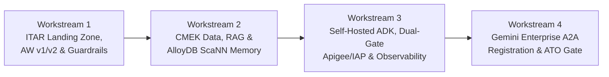

# [Project/Customer Name]: Phased ITAR Agent Delivery & Compliance Hardening Plan

> **Document Realm**: Phased Delivery & ATO Readiness Plan (No Application Code)
> **Prerequisite**: Approved Phase 2 ITAR Reference Architecture

---

## 1. Delivery Roadmap Overview

---

## 2. Workstream Breakdown & Acceptance Criteria

### Workstream 1: Assured Workloads ITAR Landing Zone & Guardrails
- **Objective**: Establish the US-sovereign compliance perimeter, CMEK key hierarchy, and preventative/detective Organization Policies before provisioning any data or compute resources.
- **Key Deliverables**:
  1. Assured Workloads `OFFERING_ITAR` folder and project hierarchy managed exclusively via `console.us.cloud.google.com` — either **Greenfield AW v1 (`CONSUMER_FOLDER`)** or **Brownfield AW v2 / Compliance Manager (`Detective` Monitor Mode -> CES drift remediation -> `Preventive` Mode)** plus a companion **Custom `Detective` Cloud Control Framework** for enterprise-specific CEL checks.
  2. Cloud KMS / Cloud HSM key rings in `us` and target US regions with `destroyScheduledDuration >= 30 days`.
  3. Modular, `terraform validate`-verified VPC network topology (`network-tf-generation`) with Private Google Access (`restricted.googleapis.com` `199.36.153.4/30`), Private Service Connect (PSC) endpoints, and a VPC Service Controls (VPC-SC) perimeter covering `aiplatform.googleapis.com`, `discoveryengine.googleapis.com`, `run.googleapis.com`, `alloydb.googleapis.com`, `redis.googleapis.com`, `storage.googleapis.com`, `bigquery.googleapis.com`, `apigee.googleapis.com`, and `dlp.googleapis.com`.
  4. Organization Policies enforced (`vertexai.allowOnlyITARCompliantAPIs`, `disableGenAIGoogleSearchGrounding`, `disableGenAIGoogleMapsGrounding`, `allowedGenAIModels`, `gcp.resourceLocations`, `gcp.restrictNonCmekServices`, `compute.vmExternalIpAccess`, `run.allowedIngress`).
- **Exit / Verification Gate**:
  - Negative test confirms non-ITAR APIs (`AgentService`, `MemoryBundleService`, `gemini-2*`) are blocked with `ALLOW_ONLY_ITAR_COMPLIANT_APIS_ORG_POLICY`, and Compliance Manager CES reports 100% across `locationScore`, `serviceScore`, and `cmekScore`.

### Workstream 2: ITAR Data, Grounding & Dual-Tier Memory Foundation
- **Objective**: Stand up the CMEK-encrypted persistence, hybrid vector memory, and ACL-enforced enterprise RAG stores replacing managed Agent Sessions and Memory Bundles.
- **Key Deliverables**:
  1. **Memorystore for Redis** instance in Private VPC with `SERVER_AUTHENTICATION` TLS, Redis AUTH, and CMEK encryption for hot session state.
  2. **AlloyDB for PostgreSQL** cluster with CMEK encryption across primary/read pools/backups, `ENCRYPTED_ONLY` SSL, **AlloyDB Auth Proxy** (TLS 1.3 + IAM authentication `alloydb.iam.authentication = 'on'`), locked `search_path = pg_catalog, pg_temp`, **Multi-Zone HA + Continuous Backup (14–35 day PITR)**, `pgvector` / `alloydb_scann` auto-maintenance (`num_leaves` tuned, `scann.satisfy_limit = 'relaxed_order'`), Reciprocal Rank Fusion (RRF) hybrid search, Row-Level Security (RLS) policies, and **MCP Toolbox for Databases** parameterized tool definitions.
  3. **Cloud Pub/Sub** CMEK-encrypted topic and dead-letter queue for asynchronous post-turn memory extraction and consolidation.
  4. **Vertex AI Search** (`discoveryengine.us.rep.googleapis.com`) DataStores registered with multi-region `us` CMEK and source ACL enforcement (`aclEnabled: true`).
- **Exit / Verification Gate**:
  - Cross-tenant RLS isolation test verifies User A cannot query or vector-match User B's session or semantic memory records, and PITR recovery drill succeeds within target RTO.

### Workstream 3: Self-Hosted ADK Runtime, Dual-Gate Governance, Sandboxes & Sovereign Observability
- **Objective**: Deploy the containerized ADK agent runtime, asynchronous memory consolidation service, Dual-Gate governed BYO-MCP tool servers, zero-egress execution sandboxes, and Three-Tier Sovereign Agent Observability.
- **Key Deliverables**:
  1. Containerized **ADK Orchestrator & Sub-Agent** services on Cloud Run (`run.googleapis.com/ephemeral-disk-disable: "true"`, CMEK revision key, disabled `run.app` URL, Direct VPC Egress) using separated `<agent>-app` runtime and `<agent>-runner` CI/CD service accounts, pinned to `https://aiplatform.us.rep.googleapis.com`.
  2. **Asynchronous Memory Consolidation Worker** on Cloud Run subscribing to Pub/Sub turn events and generating `text-embedding-005` vectors via `aiplatform.us.rep.googleapis.com`.
  3. **Dual-Gate Agent Ingress & Egress Governance**:
     - Inbound `CLIENT_TO_AGENT` gate via **Internal/Regional ALB + Cloud Armor WAF (`sqli-v33-stable`) + IAP** and **Cloud DLP** (`dlp.us.rep.googleapis.com`).
     - Outbound `AGENT_TO_ANYWHERE` gate via **Apigee X** over Private Service Connect (PSC) Network Attachments, enforcing **IAP / Envoy `AuthzPolicy` CEL tool-level conditions** (`iap.googleapis.com/mcp.toolName`, `iap.googleapis.com/mcp.tool.isReadOnly == true`) and **Apigee Service Extension (`ext-proc`, `EXTENSIBLE`)** per-model token quotas (`llm-token-quota`).
  4. **Three-Tier Sovereign Agent Observability**: Cloud Trace (`otel_to_cloud=True`), privacy-preserving Cloud Logging (`ADK_CAPTURE_MESSAGE_CONTENT_IN_SPANS=false` / `NO_CONTENT`) in a CMEK `us` Log Bucket, and **BigQuery Agent Analytics** (`--bq-analytics`) in CMEK BigQuery.
  5. *(If code/document execution is required)* **GKE Private Cluster** with `gVisor` Sandbox node pool, `restricted` Pod Security Standards, Secret Manager CSI Driver, and Dataplane V2 `DENY ALL` egress `NetworkPolicy` + `NetworkLogging`.
- **Exit / Verification Gate**:
  - Cloud Run revision inspection confirms `ephemeral-disk-disable: "true"`, disabled `run.app` URL, and CMEK attachment on 100% of deployed services; IAP CEL rules block unauthorized mutating MCP tool calls.

### Workstream 4: Gemini Enterprise App A2A Surfacing & Pre-ATO Verification
- **Objective**: Harden the Gemini Enterprise App Engine configuration, register the self-hosted ADK agent via A2A mode, and complete end-to-end compliance validation.
- **Key Deliverables**:
  1. Gemini Enterprise `Engine` patched on `discoveryengine.us.rep.googleapis.com` with `personalization-memory: FEATURE_STATE_OFF`, `prompt-gallery: FEATURE_STATE_OFF`, `notebook-lm: FEATURE_STATE_OFF`, `agent-sharing: FEATURE_STATE_OFF`, and `disableUserEventsCollection: true`.
  2. Self-hosted ADK agent registered in Gemini Enterprise using **A2A Registration Mode (`--registration-type a2a`)** pointing to `/a2a/app/.well-known/agent-card.json`, with `roles/run.servicesInvoker` granted to `service-<PROJECT_NUMBER>@gcp-sa-discoveryengine.iam.gserviceaccount.com` and Workforce Identity OAuth/OIDC token propagation verified.
  3. End-to-end Cloud Audit Log verification (`DATA_READ`, `DATA_WRITE`, `ADMIN_READ`) routed to a CMEK-encrypted US regional Log Bucket.
- **Exit / Verification Gate**:
  - Complete Pre-ATO Verification Checklist (`references/hardening-checklist.md`) passes with zero findings.
