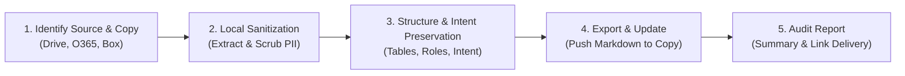

# Playbook Sanitization

## Overview

The `playbook-sanitization` skill empowers the agent to sanitize, clean, and
anonymize legal playbooks and guidance documents. It is specifically designed to
handle requests for preparing internal legal documents for external sharing by
removing Personally Identifiable Information (PII) and internal references (such
as go/links or corporate URLs), while strictly preserving the exact legal
intent, obligations, penalties, and escalation requirements.

## Key Capabilities

-   Automatically identifies the document source and uses the appropriate Native
    Gemini Connectors (supports Google Workspace, Office365, Docusign, and
    more).
-   Employs a **Copy First** mechanism to ensure the original document is never
    accidentally modified.
-   Safely sanitizes text locally, preserving critical structures like markdown
    tables and headers.
-   Replaces specific individual names with generic functional roles (e.g.,
    changing "John Doe" to "[Lead Counsel]").
-   Updates the copied document with the sanitized content and provides a brief
    audit report of the replacements.

## How it Works (Core Pattern)



1.  **Identify Source & Copy**: The agent determines the platform from the URL
    and creates a duplicate of the target document using native enterprise
    connectors.
2.  **Local Sanitization**: Raw content is extracted and scrubbed locally. PII
    and internal links are removed, but legal meaning is 100% preserved.
3.  **Structure & Intent Preservation**: Critical formatting structures
    (markdown tables, headers) are safely maintained, and specific individual
    names are replaced with standardized functional roles (e.g., "[Lead
    Counsel]").
4.  **Export & Update**: The sanitized content is formatted as clean markdown
    and pushed back to the newly copied document.
5.  **Audit Report**: The agent provides a summary of replacements and a direct
    link to the sanitized copy.

## Directory Structure

```
playbook_sanitization/
├── SKILL.md                          # Master skill orchestrator and sanitization rules
├── README.md                         # Architecture, capabilities, and workflow guide
├── BUILD                             # Bazel build and validation target
├── EVAL.txtpb                        # Automated evaluation suite (20 test cases)
├── references/                       # Reference guidance and connector configs
└── OWNERS                            # Maintainer ownership metadata
```

## Examples of How to Use the Skill

Here are some example prompts you can use to trigger this skill:

### Example 1: Sanitizing a Standard NDA
**Prompt:**

> "Please sanitize the Standard NDA playbook at
> https://docs.google.com/document/d/1dKvSwXzRO06b99cgF9Tmbro8UNxPwLlPXtMsVQCgkSc."

**Expected Outcome:** All PII and internal links are stripped. Specific names
are replaced with generic roles (e.g., Commercial Counsel), while negotiation
terms, fallback rules, and escalation requirements are strictly preserved.

### Example 2: Preparing Guidelines for External Sharing
**Prompt:**

> "Sanitize our Vendor Security Audit guidelines
> (https://docs.google.com/document/d/1FFipkuNuZs8Mee6PiMJl7s8eR3NOy1ZaOcCLw2hhz08)
> suitable for external sharing."

**Expected Outcome:** The agent will create a copy of the document, scrub any
internal email addresses and PII, retain generic role names, and provide a link
to the cleaned copy.

### Example 3: Full Workflow on a Specific Playbook
**Prompt:**

> "Perform full playbook sanitization on the Open Source Compliance guide at
> https://docs.google.com/document/d/14zDsgYCztu60hwBtBoY_ElUsSqSkYZ7WxgL6Bh6Zis0."

**Expected Outcome:** Internal links to compliance trackers are removed, public
reference links (e.g., Apache 2.0 URL) are retained, and rules around license
tiers (Green, Yellow, Red) and their corresponding escalation triggers are kept
fully intact.
