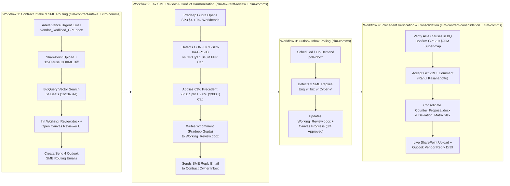

# Cymbal Aerospace CLM (`BA-2026-AV-8921`) — End-to-End UX Architecture Plan, Cognitive Ergonomics & 12-Variation Evaluation Harness Specification

**Author:** `researcher_ux_patterns` (Aerospace CLM Persona & Interaction Architect)  
**Target Deal:** `BA-2026-AV-8921` — *Apex AeroSystems Inc. ($45,000,000 Firm-Fixed-Price | FCC-900 Triple-Redundant Fly-By-Wire Flight Control Computer Subsystem, 300 Shipsets)*  
**Target Deliverable:** `cymbal_clm_ui_lab_12_variations.html` + Production Skill Workbench Upgrades (`clm-contract-intake`, `clm-comms`, `clm-tax-tariff-review`, `clm-contract-consolidation`)

---

## 1. Executive Summary & Core UX Thesis

Aerospace prime subcontract negotiations (`GP1` General Provisions + `SP3` International/Tariff + `SP5` Cyber/DFARS) fail in traditional CLM interfaces because **two fundamentally different cognitive modes** are forced into a single static screen:

1. **Orchestration & Portfolio Triage Mode (Contract Owner — Rahul Kasanagottu):** Needs macro-visibility across all 12 clauses (`8` untouched auto-cleared vs. `4` redlined exceptions), cross-clause financial locks (`GP1 §3.1` `$45M` Firm-Fixed-Price SOW ceiling), multi-SME routing status in Microsoft Outlook (`Drafts` $\rightarrow$ `Sent` $\rightarrow$ `Inbox` replies), BigQuery historical precedent distributions (`64` Tier-1 Avionics deals, `16` per redlined clause), and 1-click consolidation into `.docx` (with native OOXML Track Changes and human-attributed `<w:comment>` nodes) and `.xlsx` (4-tab SharePoint Deviation Matrix).
2. **Deep Clause Surgery & Regulatory Verification Mode (Domain SMEs — Megan Bowen, Lee Gu, Pradeep Gupta, Alex Wilber):** Needs zero-clutter reading of the exact clause text, immediate visual distinction between *(a) what the vendor changed against Cymbal's baseline* and *(b) what Cymbal's counter-position changes against the vendor's redline*, 1-click Playbook preset application (`Hold Firm`, `Tier-1 Compromise`, `Accept Vendor`, `Custom Harmonized`), live word-level diff rewriting, and margin commenting attributed directly to their human identity (`w:author="<Human Name>"`).

This specification defines:
- **Section 2:** The 5 Persona Cognitive Profiles & Decision Mental Models.
- **Section 3:** The End-to-End 4-Workflow User Journey & State Transition Architecture.
- **Section 4:** The 5 Non-Negotiable Micro-Interaction Specifications (Counter-Position Diff Resolution, Live LCS Inline Rewriting, Human `<w:comment>` Attribution, 64-Deal BigQuery Precedent Grounding, and Cross-Clause Conflict Harmonization).
- **Section 5:** Architectural Blueprint for the 12-Variation Mockup Lab (`cymbal_clm_ui_lab_12_variations.html`) mapping each variation to specific persona pain points.
- **Section 6:** Complete Specification for the **Interactive UX Evaluator & Notes Drawer** (`ux_evaluation_notes.json` schema, component keep-toggles, star ratings, and 1-click export).

---

## 2. Persona Cognitive Ergonomics & Decision Mental Models

### 2.1 Persona Matrix Across Deal `BA-2026-AV-8921`

| Persona | Role & Org | Primary Clauses Owned | Core Guardrail / Lockout | Historical BigQuery Precedent ($n=16$ per clause) | Primary UI Cognitive Need |
| :--- | :--- | :--- | :--- | :--- | :--- |
| **Rahul Kasanagottu** | **Contract Owner** (Sr. Procurement Specialist, Avionics Subcontracts) | All 12 Clauses + **`GP1 §3.1`** (`$45M` FFP Lock) + final consolidation of **`GP1 §19 & §24`** | **`GP1 §3.1` Firm-Fixed-Price Ceiling** (`$45,000,000` across 300 shipsets @ `$150,000`/shipset; no unilateral surcharges) | Reviews all `64` deals across 4 clauses (`88%`, `69%`, `63%`, `94%`) | High-signal progress dashboard, Outlook SME routing status, cross-clause conflict alert banner, and full 12-clause Working Document preview (`BA-2026-AV-8921_Working_Review.docx`). |
| **Megan Bowen** | **Engineering & Quality SME** (Principal FAA DER, Flight Controls QA) | **`GP1-12` (`GP1 §12.2`)** — *Warranty & FAA Source Inspection* (`GP1 §5.2` & `§7.1` untouched) | **HARD REGULATORY LOCKOUT:** `FAA 14 CFR Part 21.140` & `AS9100 Rev D` prohibit 30-day advance notice for FAA/Cymbal source inspections; `36-month` airworthiness warranty from aircraft delivery. | **`88%` Held Firm** (`14/16` deals), `13%` Tier-1 Compromise (`2/16`), `0%` Accepted Vendor (`0/16`). Top match: *Honeywell Aerospace `BA-2025-AV-4102` (84.9% sim)*. | Immediate statutory lockout badge (`FAA 14 CFR Part 21.140`), side-by-side comparison of vendor's `12-mo shipment / 30-day notice` vs. Cymbal's `36-mo delivery / unannounced inspection`, and 1-click **Reject Vendor / Hold Firm**. |
| **Lee Gu** | **Legal & IP SME** (VP Aviation Legal & Chief IP Counsel) | **`GP1-19` (`GP1 §19 & §24`)** — *Limitation of Liability & IP Indemnity* (`GP1 §15.1` & `§28.1` untouched) | **Corporate Legal Playbook Tier-1 Guardrail:** Reject `1x PO ($45M)` cap and broad combination IP carveout; permit `2.0x PO ($90M)` Super-Cap on general direct damages only if AD recalls, gross negligence, cyber, and system-level IP indemnity remain uncapped. | **`69%` Tier-1 Compromise** (`11/16` deals), `25%` Held Firm (`4/16`), `6%` Accepted Vendor (`1/16`). Top match: *Honeywell Aerospace `BA-2025-AV-4102` (85.1% sim)*. | Precision surgical diff editor showing the `$45M` $\rightarrow$ `$90M (200% PO)` Super-Cap substitution and narrowing the IP carveout strictly to *"solely from Cymbal Aerospace's proprietary flight control bus specifications"*. |
| **Pradeep Gupta** | **Global Tax & Trade SME** (VP Global Tax, Customs & Trade) | **`SP3-04` (`SP3 §4.1`)** — *Customs, Duties & International Tariffs* (`SP3 §2.1` ITAR/EAR untouched) | **CROSS-CLAUSE CONFLICT (`CONFLICT-SP3-04-GP1-03`):** Vendor's uncapped `100% pass-through >5%` on Section 232/301 titanium & wafer tariffs violates **`GP1 §3.1`** (`$45M` FFP SOW ceiling). | **`63%` Tier-1 Compromise** (`10/16` deals: `50/50 split >5.0% capped at +2.0% / $900K`), `31%` Held Firm (`5/16`), `6%` Accepted Vendor (`1/16`). Top match: *Honeywell `BA-2025-AV-4102` (83.5% sim)*. | Visual linkage between `SP3 §4.1` and `GP1 §3.1`, financial impact calculator (`2.0% cap = $900,000 max exposure` vs. uncapped pass-through), and 1-click **Harmonize Conflict** button. |
| **Alex Wilber** | **Cyber Defense SME** (CISO & Lead Supplier Cyber Defense) | **`SP5-03` (`SP5 §3.2`)** — *Cybersecurity Incident Reporting (DFARS)* | **HARD REGULATORY LOCKOUT:** `DoD DFARS 252.204-7012`, `NIST SP 800-171 Rev 2`, and `CMMC 2.0 Level 2` mandate **`72-hour`** cyber incident reporting upon discovery and `90-day` forensic media preservation. | **`94%` Held Firm** (`15/16` deals), `6%` Tier-1 Compromise (`1/16` — 72-hr prelim + 5-day deep logs), `0%` Accepted Vendor (`0/16`). Top match: *Honeywell `BA-2025-AV-4102` (85.1% sim)*. | Statutory compliance checklist (`DFARS 252.204-7012` / `DIBNet 72-Hr Window`), clear rejection of vendor's `10 business days post-confirmation` redline, and 1-click **Hold Firm**. |

---

## 3. End-to-End 4-Workflow Journey & State Architecture



### 3.1 Workflow-by-Workflow Cognitive Requirements & UI State Transitions

#### Workflow 1: Contract Owner Intake, Proforma Diff & SME Routing (`clm-contract-intake` + `clm-comms`)
- **Actor:** Rahul Kasanagottu (Window 1).
- **Trigger:** Inbound email from Adele Vance (`AdeleV@36zrbd.onmicrosoft.com`) with `Vendor_Redlined_GP1.docx` and `Apex_AeroSystems_Redline_Transmittal_Memo.docx`.
- **System & UI State (`status = INGESTED` $\rightarrow$ `CONFLICT_DETECTED`):**
  1. Uploads `Vendor_Redlined_GP1.docx` to SharePoint (`sites/CymbalAerospace/Shared Documents/BA-2026-AV-8921`) alongside `Cymbal_GP1_Standard.docx`.
  2. Parses all 12 clauses (`GP1-01`, `GP1-03`, `GP1-05`, `GP1-07`, `GP1-09`, `GP1-12`, `GP1-15`, `GP1-19`, `GP1-28`, `SP3-02`, `SP3-04`, `SP5-03`), auto-clearing the `8` untouched clauses and isolating the `4` redlined exceptions (`GP1-12`, `GP1-19`, `SP3-04`, `SP5-03`).
  3. Initializes `BA-2026-AV-8921_Working_Review.docx` and opens the **Document-Style Counter-Position Reviewer UI** in Spark Canvas.
  4. Saves (or sends) 4 rich HTML SME routing emails in Microsoft Outlook `Drafts` (`Megan Bowen`, `Lee Gu`, `Pradeep Gupta`, `Alex Wilber`).
- **Critical UX Requirement:** Rahul must immediately see **which 4 clauses deviated**, **why `SP3 §4.1` conflicts with `GP1 §3.1`**, and **which SME owns each clause**, while having the ability to inspect the inline counter-position diff on the emerald stage right away.

#### Workflow 2: Tax SME Review & Cross-Clause Conflict Resolution (`clm-tax-tariff-review` + `clm-comms`)
- **Actor:** Pradeep Gupta, VP Global Tax & Trade (Window 2).
- **Trigger:** Pradeep reviews `SP3 §4.1` (*Customs, Duties & International Tariffs*).
- **System & UI State (`SP3-04`: `CONFLICT` $\rightarrow$ `APPROVED`):**
  1. Surfaces `CONFLICT-SP3-04-GP1-03`: Apex AeroSystems deleted Cymbal's DDP all-inclusive tariff language and inserted an uncapped `100% pass-through of Section 232/301 titanium and wafer tariffs >5%`, violating `GP1 §3.1` (`$45,000,000` FFP ceiling).
  2. Displays BigQuery Tax Precedents (`16` Tier-1 Avionics deals: **`63%` (10/16)** resolved via a **50/50 shared tariff split above 5.0%, strictly capped at a maximum aggregate adjustment of +2.0% (`$900,000`) of the `GP1 §3.1` FFP unit price**).
  3. Pradeep clicks **`✓ Accept changes`** (or runs `tax-review`), applying the harmonized counter-position cleanly into `BA-2026-AV-8921_Working_Review.docx` and writing his margin comment attributed to `w:author="Pradeep Gupta"`.
  4. Delivers `[SME REVIEW UPDATE: TAX — SP3 §4.1]` (alongside Engineering & Cyber SME updates) to the Contract Owner's Outlook `Inbox`.

#### Workflow 3: Scheduled / On-Demand Outlook Inbox Polling (`clm-comms`)
- **Actor:** Rahul Kasanagottu (Window 1).
- **Trigger:** Scheduled 5-minute cron (`/schedule`) or on-demand `poll-inbox`.
- **System & UI State (`3 of 4 Redlined Clauses Approved`):**
  1. Polls Microsoft Outlook `Inbox` (`m365-admin@rahulsankrut.demo.altostrat.com`) and ingests SME sign-offs for:
     - `GP1-12` (`Megan Bowen` — **APPROVED**, Held Firm `88%` precedent),
     - `SP3-04` (`Pradeep Gupta` — **APPROVED**, Harmonized 50/50 split + `2.0%` cap, `63%` precedent),
     - `SP5-03` (`Alex Wilber` — **APPROVED**, Held Firm 72-Hr DFARS lockout, `94%` precedent).
  2. Highlights that **only `GP1-19` (`GP1 §19 & §24` Limitation of Liability & IP Indemnity)** remains for final precedent verification and sign-off.

#### Workflow 4: Owner Precedent Verification across All 4 Positions, Final Consolidation & Vendor Reply (`clm-contract-consolidation` + `clm-comms`)
- **Actor:** Rahul Kasanagottu (Window 1, acting on Legal Playbook guidance from Lee Gu).
- **Trigger:** `precedents --clause-id ALL` + `consolidate` + `draft-vendor-reply`.
- **System & UI State (`status = COUNTER_PROPOSAL_GENERATED`):**
  1. Verifies all `64` historical precedents across all 4 positions and confirms the `69%` (`11/16` deals) Tier-1 Playbook Compromise on `GP1-19`: **`2.0x PO ($90,000,000) Super-Cap`** on general direct damages, with uncapped liability for Fleet Airworthiness Directive (`AD`) recalls, gross negligence, cyber/confidentiality, and system-level IP indemnity (narrowing the IP carveout strictly to Cymbal Aerospace proprietary flight control bus specifications).
  2. Consolidates `BA-2026-AV-8921_Working_Review.docx` into:
     - `BA-2026-AV-8921_Cymbal_Counter_Proposal.docx` (with native Word `<w:del>`/`<w:ins>` Track Changes against the vendor redline and `<w:comment>` margin notes attributed to `Megan Bowen`, `Rahul Kasanagottu`, `Pradeep Gupta`, and `Alex Wilber`),
     - `BA-2026-AV-8921_SharePoint_Deviation_Matrix.xlsx` (4 tabs: `Executive Summary`, `Clause Sign-Off Matrix`, `BigQuery Precedents`, `Immutable Audit Trail`).
  3. Uploads both files live to SharePoint and creates (or sends) the Outlook reply draft to Adele Vance with both files attached.

---

## 4. Specification of the 5 Critical UI Micro-Interactions

Every variation in the 12-Variation Mockup Lab (`cymbal_clm_ui_lab_12_variations.html`) and the production Canvas Workbench MUST implement these 5 micro-interactions with zero friction:

### 4.1 Micro-Interaction 1: Visualizing the Counter-Position Diff & Clean Resolution State
Reviewers often get confused between **"What did the vendor redline?"** and **"What is Cymbal proposing back?"** The UI must solve this unambiguously:

1. **Default Active Diff Mode (`Counter-Position Changes to Accept`):**
   - Computes a deterministic word-level Longest Common Subsequence (LCS) diff between `vendor_redline_text` (old) and `proposed_counter_text` (new).
   - **Rejected Vendor Span (`<del class="diff-del">`):** Rendered inline with high-contrast **Orange-Red Strikethrough (`#e04f33`, `2.5px` solid line)** over slate text (`#334155`) so it remains completely legible while unmistakably marked for deletion.
   - **Proposed Cymbal Counter-Position Span (`<ins class="diff-ins">`):** Rendered inline with a warm **Coral-Peach Highlight (`#f9d8d0` fill, `#1e293b` text, `4px` border radius, `2px 6px` padding)**.
2. **1-Click Diff Perspective Switcher:**
   - Users can toggle between:
     - **`🎯 Counter-Position Diff (Vendor → Cymbal Counter)`** *(Default for decision-making)*
     - **`📄 Vendor Redline Diff (Cymbal Proforma → Vendor Markup)`** *(For understanding what Apex AeroSystems originally changed)*
     - **`⚖️ 3-Column Synchronized Split (Baseline | Vendor Redline | Counter-Proposal)`**
     - **`📑 Full 12-Clause Working Document Preview (`BA-2026-AV-8921_Working_Review.docx`)`**
3. **Clean Accepted Resolution State (`show_clean_accepted = true`):**
   - The moment the user clicks **`✓ Accept changes`** in the floating action card, the noisy strikethrough/highlight markup resolves smoothly into a **Clean Accepted Contract Block** (`#f0fdf4` emerald tint, `#10b981` left border) showing the exact final text as it appears in `BA-2026-AV-8921_Working_Review.docx`, stamped with:
     - `✓ Change Accepted & Applied to Contract Document (by <Human Reviewer Name>)`
     - A toggle button (`🔍 Inspect Redline Strikethrough` $\leftrightarrow$ `📄 Show Accepted Clean Document`) so the user can always flip back to inspect the underlying redline diff without losing their approval state.

### 4.2 Micro-Interaction 2: `✦ Rewrite with Input` & Playbook Preset Pills
When a user clicks **`✦ Rewrite with Input`** on the floating action menu (or inline toolbar):

1. **Playbook Preset Pills (Instant Application):**
   - Renders 3 (or 4 for `SP3-04`) one-click Playbook option pills backed by `precedent_analysis.playbook_options`:
     - **`Option A — Hold Firm (Cymbal Baseline)`**
     - **`Option B — Playbook Tier-1 Compromise`** *(Badged `RECOMMENDED` on `GP1-19` & `SP3-04`; badged `TIER-1 FALLBACK` on `GP1-12` & `SP5-03`)*
     - **`Option C — Accept Vendor Redline`** *(Badged `🔒 REGULATORY LOCKOUT VIOLATION` on `GP1-12` & `SP5-03`; badged `⚠️ TRIGGERS GP1 §3.1 SOW CAP CONFLICT` on `SP3-04`)*
2. **Real-Time Word-Level Diff Recalculation (`oninput`):**
   - Typing or editing any word inside the `#rewrite-textarea` triggers `computeWordDiffHtml(clause.vendor_redline_text, textarea.value)` in `<10ms`, updating the orange-red strikethrough and coral-peach highlight on the contract sheet **live as the user types**.
3. **Guardrail & Conflict Live Linter:**
   - As the user edits text or switches presets, a live guardrail indicator checks whether mandatory statutory tokens are preserved:
     - `GP1-12`: Checks for `"unannounced"` and `"24"` or `"36"` months (`FAA 14 CFR Part 21.140`).
     - `GP1-19`: Checks for `"200%"` / `"$90"` and `"uncapped"` recall/IP carveout.
     - `SP3-04`: Checks for `"2.0%"` / `"$900,000"` cap (`GP1 §3.1` FFP harmony).
     - `SP5-03`: Checks for `"seventy-two (72) hours"` / `"72 hours"` (`DFARS 252.204-7012`).

### 4.3 Micro-Interaction 3: Human User Commenting (`w:author`) & Margin Cards
In enterprise legal workflows, counterparty counsel rejects anonymous AI/system comments in Word Track Changes. Every comment must be authored by an accountable human officer:

1. **Human Author Selector / Input (`#reviewer-author-input`):**
   - Defaults automatically to the clause's designated human reviewer (`Megan Bowen` for `GP1-12`, `Rahul Kasanagottu` / `Lee Gu` for `GP1-19`, `Pradeep Gupta` for `SP3-04`, `Alex Wilber` for `SP5-03`), with a quick persona switcher pill or text input so the user can test signing off as any of the 5 personas.
2. **Dual Margin Display (Vendor Note vs. Cymbal Human Reviewer Comment):**
   - Displays Apex AeroSystems' inbound margin note (`clause.vendor_comment`) in a muted slate callout so the reviewer sees the vendor's excuse (e.g., *"Class-100 cleanroom shift disruption"*, *"Board 1x PO risk policy"*, *"European titanium Section 232 volatility"*, *"10-day SOC forensic triage"*).
   - Displays the Cymbal human reviewer's comment (`clause.user_comment`) in a prominent Navy/Emerald Word Margin Comment Card (`💬 Reviewer Comment in Word Margin — Added as User: <Human Name>`) and writes it directly to `word/comments.xml` (`w:author="<Human Name>"`) via `POST http://127.0.0.1:58921/api/review`.

### 4.4 Micro-Interaction 4: Precedent Grounding Across All 4 Clauses ($n=64$ Deals)
Every redlined clause (`GP1-12`, `GP1-19`, `SP3-04`, `SP5-03`) must expose its BigQuery vector search intelligence (`vertex-ai-demos-468803.boeing_clm.historical_clause_exceptions`) without requiring the user to leave the review context:

1. **Compact Precedent Distribution Bar (Always Visible or 1-Click Expandable):**
   - Shows the exact $n=16$ outcome distribution per clause:
     - `GP1-12`: **`88% Held Firm (14)`** | `13% Tier-1 Compromise (2)` | `0% Accepted (0)`
     - `GP1-19`: `25% Held Firm (4)` | **`69% Tier-1 Compromise (11)`** | `6% Accepted (1)`
     - `SP3-04`: `31% Held Firm (5)` | **`63% Tier-1 Compromise (10)`** | `6% Accepted (1)`
     - `SP5-03`: **`94% Held Firm (15)`** | `6% Tier-1 Compromise (1)` | `0% Accepted (0)`
2. **5 Named Peer Tier-1 Avionics Precedent Cards per Clause:**
   - Displays `contract_id`, `supplier_name` (*Honeywell Aerospace*, *Collins Aerospace*, *Thales Avionics*, *L3Harris Avionics*, *Safran Electronics & Defense*, *Moog Aircraft Group*, *Astronics*, *GKN Aerospace*, *Curtiss-Wright*), `boeing_program` (`787`, `737-MAX`, `777X`, `BDS`), `similarity_score` (`85.1%`, `84.9%`, etc.), `approval_authority`, and a **"Use This Precedent Language"** button that copies `final_agreed_language` into the counter-position editor.

### 4.5 Micro-Interaction 5: Cross-Clause Conflict Resolution (`SP3 §4.1` $\leftrightarrow$ `GP1 §3.1`)
- Whenever `SP3-04` is set to `accept_vendor` (or lacks a cap), the UI highlights the **Cross-Clause Conflict (`CONFLICT-SP3-04-GP1-03`)** linking `SP3 §4.1` (*Customs, Duties & International Tariffs*) to `GP1 §3.1` (*Firm-Fixed-Price SOW Cap — `$45,000,000` Ceiling*).
- Clicking **`⚡ Harmonize with GP1 §3.1 (+2.0% / $900K Cap)`** resolves `SP3-04` to the harmonized 50/50 shared tariff split capped at `+2.0%` of the FFP unit price, clears `active_conflicts` to `0`, and updates the deal status badge live.

---

## 5. Architecture of the 12-Variation CLM UI Mockup Lab (`cymbal_clm_ui_lab_12_variations.html`)

To allow the user to test competing commercial UX paradigms side-by-side on the exact same live Deal `BA-2026-AV-8921` data, `cymbal_clm_ui_lab_12_variations.html` will implement a **Single Shared Reactive State Store (`window.CLMLabState`)** powering **12 Switchable Interactive Variations**:

| Var # | Variation Name & Paradigm Inspiration | Best-Fit Persona(s) & Workflow(s) | Core Layout & Unique Interaction Pattern Being Tested |
| :---: | :--- | :--- | :--- |
| **V1** | **Emerald Stage & Floating Action Popover** *(Spellbook / Robin AI / Ivo — User Screenshot Baseline)* | All 5 Personas • Workflows 1, 2, 4 | Centered white legal sheet on an `#237a5b` emerald stage with inline orange-red strikethrough (`#e04f33`) + coral highlight (`#f9d8d0`), paired with the right-hand floating 4-button action card (`✦ Rewrite with Input`, `✓ Accept changes`, `✕ Reject changes`, `💬 Comment`). |
| **V2** | **Split Document + Playbook Guardrail Sidebar** *(Ironclad AI Assist / Jurist Style)* | Rahul (Owner), Lee Gu (Legal) • Workflows 1 & 4 | 2-pane split: Left scrolling full 12-clause contract with jump-to-redline markers; Right sticky Playbook Guardrail & BigQuery Precedent Inspector with 1-click option cards (`Option A`, `Option B`, `Option C`). |
| **V3** | **Traffic-Light Risk Heatmap & Clause Deviance Radar** *(Luminance Legal-Grade AI Style)* | Rahul (Owner), Exec Review • Workflow 1 Intake | Visual 12-tile clause risk matrix (Red = Regulatory/Conflict Lockout, Amber = Commercial Negotiation, Green = Auto-Cleared/Accepted) + deviance severity bars and instant drill-down into inline diff surgery. |
| **V4** | **Enterprise Financial Exposure & Guardrail Cockpit** *(Icertis Contract Intelligence Style)* | Rahul (Owner), Pradeep (Tax), Lee Gu (Legal) • Workflows 2 & 4 | Quantitative dollar-exposure cockpit modeling the `$45M` FFP baseline vs. Vendor Redline exposure (`+$4.5M` uncapped tariff risk, `$45M` vs. `$90M` liability cap gap) and real-time risk reduction as counter-positions are accepted. |
| **V5** | **3-Column Synchronized Diff Workbench** *(Litera Compare / Kira Style)* | Lee Gu (Legal), Megan (FAA), Alex (Cyber) • Deep Redline Audit | 3 locked-scroll columns side-by-side: **Col 1:** Cymbal Proforma Baseline (`Cymbal_GP1_Standard.docx`), **Col 2:** Apex AeroSystems Redline (`Vendor_Redlined_GP1.docx`), **Col 3:** Live Editable Cymbal Counter-Proposal (`BA-2026-AV-8921_Working_Review.docx`). |
| **V6** | **Guided Step-by-Step Decision Wizard & Approver Flow** *(SpotDraft VerifAI / Juro Style)* | Domain SMEs (`Megan`, `Pradeep`, `Alex`, `Lee`) • Workflow 2 | Zero-distraction 4-step guided stepper (`Clause 1 of 4: GP1 §12.2` $\rightarrow$ `2 of 4: GP1 §19` $\rightarrow$ `3 of 4: SP3 §4.1` $\rightarrow$ `4 of 4: SP5 §3.2`) with progress ring, 3 large decision cards, human comment box, and "Accept & Next Clause $\rightarrow$" flow. |
| **V7** | **Cymbal Institutional Dark Terminal** *(Bloomberg / Cymbal Capital Dark Mode Style)* | Rahul (Owner), Data/Legal Analysts • Workflow 1 & 4 Precedent Audit | High-density `#0b0f19` dark institutional terminal (inspired by Cymbal Capital screenshots) featuring live BigQuery `VECTOR_SEARCH` cosine similarity meters, SQL query inspector drawer, and keyboard-first (`J`/`K`/`A`/`R`/`C`) triage. |
| **V8** | **Multi-SME Routing Board & Live Outlook Comms Hub** *(Linear / Jira + Microsoft Outlook Split)* | Rahul (Owner) • Workflow 1 (`route-smes`) & Workflow 3 (`poll-inbox`) | Swimlane board grouped by SME Team (`Engineering`, `Legal`, `Tax`, `Cyber`) paired with an interactive **Microsoft Outlook Drafts & Inbox Preview Drawer** showing the exact HTML routing emails, SME replies, and 1-click `poll-inbox` / `route-smes` actions. |
| **V9** | **Interactive Negotiation Timeline & Version Diff Scrubber** *(GitHub PR / Version Replay Style)* | Rahul (Owner), Lee Gu (Legal) • Workflow 4 Consolidation | Horizontal timeline scrubber across 4 contract states (`v1: Cymbal Proforma` $\rightarrow$ `v2: Apex Vendor Redline` $\rightarrow$ `v3: SME Working Review` $\rightarrow$ `v4: Final Counter-Proposal`) showing exactly how each clause evolved and who authored each `<w:comment>`. |
| **V10** | **Cross-Clause Dependency & Regulatory Lockout Graph** *(Visual Node Graph Explorer)* | Pradeep (Tax), Rahul (Owner), Megan (FAA), Alex (Cyber) • Workflow 2 | Interactive SVG node-link graph connecting the 12 clauses to `GP1 §3.1 ($45M FFP Cap)`, `FAA 14 CFR Part 21.140`, `DoD DFARS 252.204-7012`, and `BigQuery 64 Precedents`. Clicking the flashing red edge `SP3 §4.1 ↔ GP1 §3.1` opens the Harmonization Surgery Drawer. |
| **V11** | **Executive Deal Room & One-Click Approval Bento Deck** *(Bento Grid Briefing + Batch Sign-Off)* | VP Procurement / Executive Gate (1:30 PM & 4:00 PM Calendar Gates) | Executive Bento Grid summarizing Deal `BA-2026-AV-8921`, all 4 redline counter-positions, human reviewer comments, SharePoint artifact links (`.docx` & `.xlsx`), and 1-click **"Approve All 4 Recommended Positions & Generate Package"**. |
| **V12** | **Conversational Spark Co-Pilot + Live Redline Canvas Split** *(Harvey / Claude Artifacts / Spark Canvas Style)* | All 5 Personas • End-to-End 4-Workflow Live Simulation | Left pane: Interactive simulated Spark CLM Co-Pilot chat with 1-click workflow prompt chips (`Ingest & Route`, `Tax SME Harmonize`, `Poll Outlook Inbox`, `Consolidate & Draft Reply`); Right pane: Live reactive Emerald Document Reviewer updating as prompts run. |

---

## 6. Specification: Interactive UX Evaluator & Notes Harness

So the user can methodically test all 12 variations, record what they like/dislike, pick specific components to combine into the final production UI, and save/export their notes without losing anything across page reloads, `cymbal_clm_ui_lab_12_variations.html` MUST include a persistent, collapsible **UX Evaluator & Notes Bar**.

### 6.1 Evaluator UI Layout & Ergonomics
- **Positioning:** Docked at the bottom-right (or toggleable full-width bottom drawer / slide-over panel via a floating pill **`📝 UX Test Lab & Notes (12 Variations)`** + keyboard shortcut `Cmd/Ctrl + E`) so it **never blocks** the active variation's layout when minimized, and expands cleanly when taking notes.
- **Top Variation Switcher Strip:** Always-visible compact top bar allowing 1-click switching across `V1` through `V12`, displaying a live badge on each tab showing whether the user has rated/reviewed that variation (e.g., `V1 ★5`, `V4 ★4`, `V7 • Unrated`) plus a **Persona Context Switcher** (`Rahul Kasanagottu`, `Megan Bowen`, `Lee Gu`, `Pradeep Gupta`, `Alex Wilber`).

### 6.2 Per-Variation Evaluation Controls
For whichever variation (`V1`–`V12`) is currently active, the Evaluator Drawer provides:
1. **Overall Star Rating (`1` to `5` Stars)** + **Verdict Pill**:
   - `🏆 Primary Production Candidate`
   - `🧩 Cherry-Pick Components`
   - `🔄 Secondary / Persona-Specific View`
   - `❌ Skip / Discard`
2. **Granular Component "Keep & Incorporate" Checkboxes:**
   Allows the user to cherry-pick exact widgets from the current variation to merge into the production `cymbal_clm_redline_workbench.html`:
   - `[ ] Keep Header & KPI Strip`
   - `[ ] Keep Inline Diff & Emerald Stage`
   - `[ ] Keep Floating Action Menu (Rewrite / Accept / Reject / Comment)`
   - `[ ] Keep BigQuery Precedent Distribution & Table`
   - `[ ] Keep Cross-Clause Conflict Alert / Graph`
   - `[ ] Keep Outlook SME Routing & Inbox Tracker`
   - `[ ] Keep Persona / Author Attribution Controls`
   - `[ ] Keep Full 12-Clause Working Doc Preview`
3. **Quick Pros / Cons Tag Chips (1-Click Toggle):**
   - `+ Crystal-clear diff`, `+ Fast 1-click approval`, `+ Great executive clarity`, `+ Strong BigQuery grounding`, `+ Feels like real Word/Litera`, `- Too dense`, `- Too many clicks`, `- Hard to see all 4 clauses at once`.
4. **Freeform User Notes Textarea (Auto-Saved on Every Keystroke):**
   - Saves immediately to `localStorage.getItem('cymbal_clm_ux_eval_v1')` so refreshing the browser never loses a single character of feedback.

### 6.3 Cross-Variation Synthesis Modal & 1-Click Export Schema (`ux_evaluation_notes.json`)
Clicking **`📊 View All Notes & Export Decisions`** opens a summary matrix of all 12 variations sorted by the user's star rating and offers 3 one-click export actions:
1. **`📋 Copy Markdown Implementation Plan to Clipboard`** — Formats all ratings, cherry-picked components, and freeform notes into a clean Markdown prompt that the user can paste directly back into chat (*"Incorporate these exact UI decisions..."*).
2. **`⬇️ Download ux_evaluation_notes.json`** — Downloads the structured JSON file to disk.
3. **`💾 Save to Local Host Bridge (`http://127.0.0.1:58921`)`** — Attempts to persist `ux_evaluation_notes.json` to the workspace if the loopback bridge is active, falling back gracefully to browser download + `localStorage`.

#### Canonical JSON Export Schema (`ux_evaluation_notes.json`):
```json
{
  "deal_id": "BA-2026-AV-8921",
  "evaluated_at_utc": "2026-10-20T14:00:00Z",
  "overall_preferred_primary_variation": "V1",
  "overall_synthesis_notes": "Combine V1's Emerald Stage & Floating Action Menu with V5's 3-Column Split toggle and V8's Outlook SME Routing status drawer.",
  "variations": {
    "V1": {
      "variation_id": "V1",
      "title": "Emerald Stage & Floating Action Popover",
      "rating": 5,
      "verdict": "PRIMARY_CANDIDATE",
      "keep_components": [
        "Keep Inline Diff & Emerald Stage",
        "Keep Floating Action Menu (Rewrite / Accept / Reject / Comment)",
        "Keep Persona / Author Attribution Controls"
      ],
      "tags": ["+ Crystal-clear diff", "+ Fast 1-click approval"],
      "notes": "Love how Accept Changes resolves cleanly into the Working Review Document."
    }
  }
}
```

---

## 7. Implementation Checklist for the 12-Variation Mockup Lab Builder

1. **Zero External Runtime Dependencies:** Embed all CSS, SVG icons, Deal `BA-2026-AV-8921` seed data (all 12 clauses, all 4 redlined diffs, all `64` BigQuery precedent summary stats & top 5 peer deals per clause, `CONFLICT-SP3-04-GP1-03`, and the 4 Outlook SME email templates), and the LCS word-diff engine (`computeWordDiffHtml`) inside `cymbal_clm_ui_lab_12_variations.html` so it opens instantaneously in any browser or Spark Canvas.
2. **Real-Time State Sharing Across All 12 Variations:** Accepting a clause, editing counter-position text via `✦ Rewrite with Input`, harmonizing `SP3-04`, or adding a human comment (`w:author`) in **any** variation (`V1`–`V12`) immediately updates `window.CLMLabState` and syncs to `http://127.0.0.1:58921/api/review` so switching to another variation reflects the live state.
3. **Interactive Demo State Resetter:** Include a **`🔄 Reset Deal State (Initial Conflict vs. 3/4 Polled vs. 4/4 Consolidated)`** quick-switcher in the lab header so the user can test how every variation looks in Workflow 1 (`INGESTED`/`CONFLICT_DETECTED`), Workflow 2 (`SP3-04 Harmonized`), Workflow 3 (`3/4 SMEs Replied`), and Workflow 4 (`4/4 Consolidated`).
